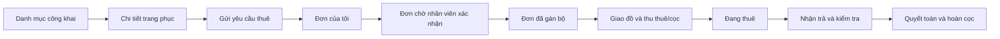

# Kế hoạch thiết kế và triển khai giao diện

**Ngày lập:** 03/10/2026

**Bản code được rà soát:** `main` tại commit `2122f0e18375e023c367483256c464bec123ced4`

**Trạng thái:** kế hoạch để nhóm thống nhất trước khi triển khai UI nghiệp vụ.

Quy chuẩn token, trạng thái tổng hợp, tình huống lỗi và wireframe cho năm màn hình đầu nằm ở [Quy chuẩn thiết kế giao diện và năm màn hình lõi](Quy%20chuẩn%20thiết%20kế%20giao%20diện%20và%20năm%20màn%20hình%20lõi.md).

## 1. Căn cứ và hiện trạng

Nguồn nghiệp vụ hiện hành là [`business-rules.md`](business-rules.md). Khi thiết kế dữ liệu hoặc API, đối chiếu tiếp `apps/api/prisma/schema.prisma` và migration như thứ tự nguồn chuẩn trong [`README.md`](README.md). Tài liệu phân tích dài trước đây là tài liệu lịch sử; các đề xuất chưa vào schema không được mô tả như chức năng đã có.

| Hạng mục | Hiện trạng trong code | Tác động lên kế hoạch UI |
|---|---|---|
| Frontend | React 19, Vite 8, TypeScript, Tailwind CSS 4; `App.tsx` trả về giao diện rỗng; chưa có router, màn hình, component hay dữ liệu mẫu trên web | Bắt đầu từ hệ thống điều hướng, design tokens và luồng mẫu; không sửa một UI nghiệp vụ đang tồn tại |
| Backend | Express có `/health`, `/health/ready`, lớp lỗi và response chung; chưa có API danh mục, xác thực, đơn, kho, thanh toán, CRM | Làm prototype bằng fixture có nhãn demo và lớp gọi API thay thế được; không coi prototype là chức năng đã kết nối |
| Dữ liệu | Prisma schema và migration gồm 32 bảng; seed `core` và `demo` có chi nhánh, role, mẫu, bộ, nhiều trạng thái đơn và giao dịch mẫu | Dùng các tình huống seed làm dữ liệu thiết kế/kiểm thử; chưa mặc định rằng API đã đọc được seed |
| Nhận diện thương hiệu | Chưa thấy bộ nhận diện/logo/ảnh trang phục thật; `hero.png` hiện là hình kỹ thuật chung | Đề xuất hướng hình ảnh tạm thời, chờ ảnh và màu thương hiệu trước khi chốt giao diện công khai |

## 2. Nghiệp vụ phải phản ánh đúng trên giao diện

| Mảng | Quy tắc hiện hành | Hệ quả thiết kế |
|---|---|---|
| Đặt thuê | Khách gửi online hoặc nhân viên lập tại quầy; `PENDING_CONFIRMATION` chưa giữ bộ | Hiển thị rõ “Yêu cầu đang chờ xác nhận, chưa giữ trang phục”; nhân viên phải gán bộ khi xác nhận |
| Trang phục | Mẫu → biến thể size/màu/edition → từng bộ có barcode; một `rental_order_item` ứng với một bộ | Khách có thể chọn số bộ, nhưng hệ thống tạo từng dòng tương ứng; màn hình nội bộ phải cho thấy mã bộ cụ thể |
| Khả dụng | Bộ chỉ cho thuê khi `READY` và không vướng đơn/block trong kỳ thuê | Tìm theo chi nhánh và khoảng nhận/trả; khi xác nhận hết bộ, báo xung đột và cho nhân viên chọn lại |
| Giá | Giá/ngày, cọc và giá thay thế ở `costume_variants`, dùng chung toàn chuỗi; đơn giữ snapshot | Trang giá hiển thị theo biến thể, không hứa giá riêng từng chi nhánh hoặc lịch đổi giá khi schema chưa hỗ trợ |
| Ngày thuê | Phiên bản chính sách cấu hình `ROLLING_24_HOURS` hoặc `CALENDAR_DAY`; seed hiện hành dùng 24 giờ liên tục | Tóm tắt báo giá phải nêu số ngày tính tiền và cách tính từ chính sách; không tính độc lập khác backend |
| Giao trả | Khách nhận/trả cùng chi nhánh; thu tiền thuê và cọc lúc giao; trả xong kiểm tra rồi mới quyết toán/hoàn cọc | Tách các bước “giao và thu”, “nhận và kiểm tra”, “phụ phí/cấn trừ”, “hoàn cọc”; không gộp thành một nút hoàn tất |
| Thanh toán | MVP thu tiền mặt/chuyển khoản, ghi nhận thủ công; cọc không là doanh thu | Hiển thị riêng tiền thuê, cọc, phụ phí, tiền hoàn và trạng thái giao dịch; chưa đưa gateway vào hành trình chính |
| Phân quyền | Admin/Staff/Customer; quyền qua role và chi nhánh; `role_permissions` cho phép tick quyền trên role | Màn hình ma trận checkbox sửa **bộ quyền**, màn hình nhân viên gán role theo chi nhánh; mọi thao tác vẫn phải được API kiểm quyền |
| CRM | MVP có hồ sơ, tương tác và case; chưa có consent, campaign, tag, loyalty trong schema | Thiết kế màn hình hồ sơ và case trước; marketing/tích điểm để giai đoạn mở rộng |
| Đang thuê | Bộ đang thuê suy ra từ order item có phân bổ `ACTIVE`, không phải trạng thái `costume_units` riêng | Màn hình “Đang thuê” phải nối đơn, khách, chi nhánh, bộ và hạn trả; tìm theo mã bộ/mã đơn/khách |

### Quyết định đã chốt và điểm còn cần xử lý trước khi làm UI chức năng

1. **Độ chi tiết của checkbox quyền:** seed hiện có quyền `read/manage` theo module. Quyền này chưa tách “duyệt đơn”, “giao đồ”, “thu tiền”, “duyệt hoàn cọc”, “sửa giá”. Nếu bài toán yêu cầu tick độc lập từng hành động, cần mở rộng danh mục permission và kiểm tra quyền tại API trước khi hoàn thiện ma trận UI. Đề xuất tối thiểu: `rentals.confirm.branch`, `rentals.handover.branch`, `rentals.return.branch`, `payments.collect.branch`, `refunds.approve.branch`, `catalog.pricing.manage.all`.
2. **Đã chốt quyền theo role + chi nhánh:** tài liệu lịch sử đề xuất `ALLOW/DENY` cá nhân nhưng schema hiện **không có** bảng override. MVP dùng checkbox trên role và gán role theo chi nhánh; không thiết kế nút tick ngoại lệ từng nhân viên.
3. **Thay đổi giá:** schema hiện lưu giá trực tiếp trên biến thể, không có `pricing_rules` theo chi nhánh/ngày hiệu lực. Đề xuất MVP sửa giá biến thể qua màn hình quản trị, bắt buộc lý do và audit, giữ snapshot trên đơn; bộ đặc biệt dùng biến thể/edition riêng. Nếu cần đặt lịch giá hoặc giá từng chi nhánh, chốt schema mới trước khi thiết kế phần đó.
4. **Liên kết Google cho nhân viên:** quy tắc hiện hành tạo tài khoản `PENDING` trước rồi liên kết khi Google xác minh email và `sub`. API phải quyết định chính xác điều kiện liên kết và chống tự nhận quyền nhân viên; UI chỉ hiển thị các trạng thái chờ kích hoạt/khóa/không có quyền.
5. **Chuyển khoản và người nhận hộ:** `payments` chưa có trường mã tham chiếu chuyển khoản riêng; `rental_orders` chưa có người nhận hộ. Nếu studio cần hai thông tin này trên biên nhận, bổ sung dữ liệu/API trước khi đưa vào form chính thức.

Điểm 1 và 3 ảnh hưởng trực tiếp cấu trúc màn hình quản trị. Nhóm vẫn có thể dựng layout, navigation và prototype luồng thuê trong khi chờ xử lý chúng.

## 3. Kiến trúc thông tin và màn hình

Một ứng dụng web có hai khu vực: **Khách hàng** ưu tiên di động, **Vận hành/Quản trị** ưu tiên desktop nhưng giao nhận phải dùng tốt trên máy tính bảng và điện thoại. Menu nội bộ dựa trên quyền hiệu lực ở chi nhánh đang chọn, không chỉ dựa trên nhãn Admin/Staff.

| Mã | Khu vực/màn hình | Nội dung và thao tác chính | Ưu tiên |
|---|---|---|---|
| UI-01 | Công khai: danh mục | Tìm mẫu, lọc loại/size/màu/chi nhánh, chọn khoảng thuê; thẻ ảnh, giá/ngày, cọc, trạng thái khả dụng theo kỳ | P0 |
| UI-02 | Công khai: chi tiết trang phục | Ảnh, mô tả, chất liệu, size/fit, phụ kiện, biến thể, giá/ngày, cọc, điều kiện thuê, CTA kiểm tra lịch | P0 |
| UI-03 | Khách: gửi yêu cầu thuê | Luồng từng bước trên mobile: trang phục → biến thể/số bộ → chi nhánh/kỳ thuê → báo giá → liên hệ → xác nhận yêu cầu chưa giữ bộ | P0 |
| UI-04 | Khách: đơn của tôi | Danh sách/trạng thái, chi tiết giá và biên nhận; hủy chỉ khi trạng thái/chính sách cho phép | P0 |
| UI-05 | Chung: đăng nhập Google | Đăng nhập, hoàn thiện thông tin liên hệ, trạng thái tài khoản chờ/khoá, chuyển tới khu vực đúng quyền | P0 |
| UI-06 | Nhân viên: bảng việc chi nhánh | Hàng đợi ưu tiên theo hạn xử lý: đơn chờ duyệt, sắp giao, sắp trả/quá hạn, bộ cần vệ sinh/sửa, giao dịch cần xử lý | P0 |
| UI-07 | Nhân viên: không gian xử lý đơn | Bố cục master-detail, lọc/hàng đợi bên trái, chi tiết và gán barcode/xác nhận ở panel; có lịch sử và thông tin khách | P0 |
| UI-08 | Nhân viên: tạo đơn tại quầy | Tìm/tạo hồ sơ khách, chọn biến thể và kỳ thuê, báo giá, tạo đơn và xác nhận theo quyền | P0 |
| UI-09 | Nhân viên: giao đồ và thu tiền | Checklist tình trạng/phụ kiện từng bộ, quét/nhập mã bộ, ghi tiền thuê và cọc bằng tiền mặt/chuyển khoản, xác nhận giao | P0 |
| UI-10 | Nhân viên: đang thuê | Bảng từng bộ đang ở khách nào, mã đơn, chi nhánh, hạn trả, quá hạn; tìm barcode/số điện thoại | P0 |
| UI-11 | Nhân viên: nhận trả và quyết toán | Kiểm từng bộ/phụ kiện, bằng chứng, phí hư hỏng/trễ, số cọc cấn trừ/còn hoàn, trạng thái refund | P0 |
| UI-12 | Kho: bộ trang phục | Danh sách barcode và trạng thái, nhận `INBOUND`, xem lịch sử, block vệ sinh/sửa, kiểm tra khả dụng | P1 |
| UI-13 | Admin: mẫu, biến thể và giá | Tạo/sửa mô tả, ảnh, size/màu/edition, giá/ngày/cọc; cảnh báo thay giá không sửa đơn cũ | P1 |
| UI-14 | Admin: nhân viên và chi nhánh | Mời/tạo nhân viên chờ kích hoạt, gán role theo chi nhánh, khóa/ngừng phân công, quản lý chi nhánh | P1 |
| UI-15 | Admin: quyền theo vai trò | Chọn từng role, tick permission theo nhóm chức năng/scope có thật, xem trước quyền hiệu lực theo chi nhánh, xác nhận và audit | P1 |
| UI-16 | CRM: khách hàng và case | Hồ sơ, lịch sử thuê, timeline tương tác, tạo/nhận/chuyển/đóng case theo chi nhánh | P1 |
| UI-17 | Admin: chính sách/báo cáo | Xem phiên bản chính sách, cấu hình bản mới theo quyền; báo cáo đơn, doanh thu thuê, cọc đang giữ, quá hạn | P2 |
| UI-18 | Kho: điều chuyển chi nhánh | Yêu cầu, duyệt, xuất, nhận và kiểm tra từng bộ theo workflow hiện hành | P2 |

**P0** là lát cắt thuê trọn vòng đời. **P1** hoàn chỉnh vận hành nhiều chi nhánh và phân quyền. **P2** mở rộng báo cáo/chính sách và điều chuyển. Các màn hình P1/P2 có thể dựng wireframe sớm nhưng không hiển thị như chức năng thật khi API chưa có.

### Sơ đồ điều hướng đề xuất



Route gợi ý: `/`, `/trang-phuc/:ma-mau`, `/dat-thue`, `/don-cua-toi`, `/don-cua-toi/:ma-don`; khu nội bộ `/van-hanh/tong-quan`, `/van-hanh/don-thue`, `/van-hanh/dang-thue`, `/van-hanh/kho`, `/van-hanh/khach-hang`; khu quản trị `/quan-tri/danh-muc`, `/quan-tri/nhan-vien`, `/quan-tri/vai-tro`, `/quan-tri/chi-nhanh`, `/quan-tri/chinh-sach`, `/quan-tri/bao-cao`. Đây là đề xuất cấu trúc URL, chưa có router trong code.

## 4. Quy cách UX cho các luồng quan trọng

### 4.1. Gửi yêu cầu và duyệt đơn

1. Khách chọn chi nhánh, khoảng thời gian, biến thể. UI lấy giá/khả dụng từ server và hiển thị số ngày tính tiền, tiền thuê, cọc tách riêng.
2. Trước khi gửi, nêu rõ **đơn chờ nhân viên duyệt, chưa giữ bộ**; sau khi gửi, cho mã đơn và trạng thái theo dõi.
3. Nhân viên thấy hàng đợi `PENDING_CONFIRMATION` của chi nhánh, mở chi tiết, chọn đủ bộ `READY` theo barcode rồi xác nhận. Nếu bộ vừa bị người khác gán, thông báo xung đột và cập nhật danh sách; không tự chọn bộ khác âm thầm.
4. Từ chối hoặc đề nghị khách đổi kỳ thuê phải có lý do và kết quả được thể hiện trên đơn khách.

### 4.2. Giao, thu, nhận trả và hoàn cọc

1. Giao: hiển thị từng mã bộ và checklist phụ kiện/tình trạng. Nhân viên ghi riêng giao dịch **tiền thuê** và **tiền cọc**; chỉ báo đã thu sau khi xác nhận tiền mặt hoặc chuyển khoản.
2. Đang thuê: một dòng trên màn hình ứng với một bộ đang giao; cảnh báo quá hạn dựa trên `planned_due_at`, không dựa vào nhãn trạng thái kho tự suy đoán.
3. Trả: kiểm tra từng bộ/phụ kiện và lưu ảnh nếu dịch vụ lưu ảnh đã sẵn sàng; hiển thị phí trễ/hư hỏng/thiếu đồ cùng lý do trước khi cấn cọc.
4. Quyết toán: cho thấy `cọc đã thu − cấn trừ − đã hoàn = còn phải hoàn/đối soát`; phân biệt “đồ đã trả” với “tiền đã quyết toán”. Lỗi hoàn tiền giữ trạng thái cần xử lý, không đánh dấu đơn hoàn tất sớm.

### 4.3. Phân quyền và chi nhánh

- Màn hình quyền chọn **một role tại một thời điểm**, rồi tick các quyền được nhóm theo module; hiển thị scope cố định của từng mã quyền (`OWN/BRANCH/ALL`). Checkbox chỉ sửa `role_permissions`, không tạo ngoại lệ cá nhân. Nếu backend bổ sung nhiều mã scope cho cùng hành động, UI mới cho chọn giữa các scope hợp lệ.
- Màn hình nhân viên chọn chi nhánh rồi gán role; xem trước quyền hiệu lực tại chi nhánh đó. Chuyển chi nhánh trong header phải làm mới dữ liệu và menu.
- Nút bị ẩn/khóa theo quyền để dễ dùng; API vẫn là nơi quyết định cho phép. Khi mất quyền giữa phiên, chuyển đến trạng thái “Không có quyền” thay vì để thao tác thất bại mơ hồ.

## 5. Hướng thiết kế hình ảnh và component

**Hướng đã chốt:** trẻ trung, hiện đại, tối giản có điểm nhấn; nền sáng nhiều khoảng trắng, ảnh trang phục lớn, card bo vừa phải, chữ hiện đại. Khu khách hàng thiên về fashion/lifestyle; khu nội bộ là bảng việc gọn, dễ xử lý, không theo mẫu admin dashboard khô cứng. Accent hồng berry `#C0265B` là mã thử nghiệm trên nền trung tính sáng; màu chính thức cần thử với logo/ảnh thật. Token, typography, composite status và component được quy định trong [UI design contract](Quy%20chuẩn%20thiết%20kế%20giao%20diện%20và%20năm%20màn%20hình%20lõi.md).

- **Điều hướng:** khách dùng header gọn và bước đặt rõ tiến độ; nội bộ dùng sidebar theo quyền, bộ chọn chi nhánh và vùng công việc. Breadcrumb ở màn hình chi tiết.
- **Thành phần dùng lại:** thẻ trang phục, bộ lọc lịch/chi nhánh, báo giá, badge trạng thái đơn/bộ/giao dịch, bảng có lọc/sắp xếp/phân trang, biểu mẫu tiền VND, modal xác nhận, checklist giao trả, timeline, ma trận quyền.
- **Form:** nhãn luôn nhìn thấy, kiểm tra lỗi cạnh trường; khi gửi sai, có tóm tắt lỗi focus được; nút submit có trạng thái đang xử lý và phản hồi thành công/thất bại.
- **Responsive:** kiểm tra ở 375, 768, 1024, 1440 px. Danh sách khách dùng card ở màn nhỏ; bảng nội bộ chuyển sang card hoặc cuộn có kiểm soát; thao tác quét barcode luôn có nhập mã thủ công dự phòng.
- **Tiếp cận:** điều hướng bàn phím, focus rõ, mục chạm tối thiểu 44×44 px, tương phản chữ tối thiểu 4.5:1, alt cho ảnh, không dùng chỉ màu để báo lỗi/trạng thái, tôn trọng `prefers-reduced-motion`.
- **Định dạng:** số tiền VND theo `vi-VN`, thời gian theo timezone chi nhánh, hiển thị rõ giờ nhận/trả và chính sách đếm ngày. Skeleton/empty/error state phải ổn định bố cục và đưa ra hành động tiếp theo.

## 6. Cấu trúc frontend và hợp đồng API cần chuẩn bị

Tổ chức theo khu vực ứng dụng và feature, tránh đặt toàn bộ giao diện vào `App.tsx`:

```text
apps/web/src/
  app/                 # router, shell, session, branch context
  features/catalog/    # danh mục, chi tiết, khả dụng
  features/rentals/    # yêu cầu, đơn, giao, trả, đang thuê
  features/inventory/  # bộ, block, điều chuyển
  features/finance/    # thu, cọc, phụ phí, hoàn
  features/identity/   # đăng nhập, nhân viên, role, quyền
  features/crm/        # hồ sơ, tương tác, case
  shared/              # component, token, format tiền/ngày, API client
```

Trước khi nối dữ liệu thật, thống nhất response theo envelope đã có ở `apps/api/src/common/http/response.ts`. Các endpoint dưới đây là **hợp đồng đề xuất**, chưa tồn tại trong backend:

| Nhóm API cần có | Phục vụ UI | Điều kiện đặc biệt |
|---|---|---|
| Session/Google và `me` | Đăng nhập, menu/route theo quyền, chi nhánh | Backend trả quyền hiệu lực theo chi nhánh, không tin role gửi từ client |
| Chi nhánh, catalog, media, khả dụng, báo giá | UI-01 đến UI-03 | Giá và số ngày tính ở backend; lọc lịch cùng quy tắc chống trùng |
| Đơn và hành động chuyển trạng thái | UI-04, UI-07, UI-08 | Hỗ trợ version để báo xung đột sửa đồng thời; trả trạng thái/giá snapshot |
| Giao nhận, đang thuê, thanh toán, refund | UI-09 đến UI-11 | Trả từng bộ; tách thu thuê/cọc; refund tham chiếu payment nguồn |
| Kho, block, điều chuyển | UI-12, UI-18 | Phạm vi chi nhánh và workflow xuất/nhận |
| Role/permission, nhân viên, catalog/giá, policy | UI-13 đến UI-15, UI-17 | Audit và phân quyền phía server; không dùng fixture như nguồn thật |
| Khách hàng, tương tác, case, báo cáo | UI-16, UI-17 | Giới hạn dữ liệu theo chi nhánh/quyền và che thông tin nhạy cảm |

Fixture frontend chỉ phục vụ prototype, có tên/ảnh giả và không chứa dữ liệu cá nhân thật. Khi API sẵn sàng, thay adapter theo từng feature; giữ cùng trạng thái loading/empty/error và scenario đã được duyệt.

## 7. Thứ tự triển khai và tiêu chí hoàn thành

| Đợt | Công việc | Đầu ra kiểm tra được | Phụ thuộc |
|---|---|---|---|
| 0. Chốt phạm vi | Giải quyết các điểm lệch tại mục 2, xác nhận màn P0 và API contract, chọn ảnh demo đúng ngữ cảnh | Danh sách quyết định, sơ đồ luồng, dữ liệu mẫu 3 vai trò/2 chi nhánh | BA + backend + UI |
| 1. Nền UI | Router, shell khách/nội bộ, token và component theo UI design contract, trạng thái lỗi/không quyền, fixture | Prototype điều hướng được trên desktop/mobile; không có nút giả vờ ghi dữ liệu thật | Không cần API nghiệp vụ |
| 2. Lát cắt đặt và duyệt | UI-01 đến UI-08; danh mục → báo giá → yêu cầu → hàng đợi → gán bộ | Demo trọn luồng với fixture; sau đó nối API catalog/auth/rental | API và permission tương ứng |
| 3. Lát cắt giao trả tiền | UI-09 đến UI-11; giao/thu → đang thuê → trả/kiểm → hoàn | Mỗi khoản tiền, từng bộ và trạng thái quyết toán xem được; xử lý được lỗi/xung đột | API handover, finance, refund |
| 4. Quản trị và CRM | UI-12 đến UI-16, sau đó UI-17/UI-18 | Nhân viên chỉ thấy dữ liệu/quyền chi nhánh; admin sửa role/giá có audit; CRM MVP chạy | API inventory, RBAC, catalog, CRM, reports |

**Nghiệm thu P0:** khách gửi yêu cầu nhưng không thấy thông báo “đã giữ bộ”; nhân viên xác nhận không thể gán trùng một bộ; khách và nhân viên thấy cùng giá snapshot; thu tiền thuê/cọc ở bước giao; màn hình “Đang thuê” biết ai đang giữ từng barcode; hoàn cọc chỉ sau kiểm tra; người không có quyền không truy cập được hành động/API; giao diện dùng được bằng bàn phím và ở kích thước di động chính.

## 8. Câu hỏi cần chủ studio/nhóm xác nhận

1. Logo và ảnh trang phục thật đã có chưa? Nếu chưa, dùng ảnh demo có nhãn và accent tạm đã đề xuất.
2. Studio có cần giá khác theo chi nhánh hoặc đặt lịch đổi giá không? Nếu chưa, dùng giá theo biến thể toàn chuỗi như schema hiện tại.
3. Khi thu chuyển khoản, có cần mã giao dịch/người đối soát hoặc tải ảnh chứng từ? Nếu có, bổ sung dữ liệu/API trước khi chốt form thu tiền.
4. Khách có được nhờ người khác nhận/trả trang phục không? Nếu có, bổ sung thông tin người nhận thực tế và quy trình xác minh.

Các câu hỏi này không cản việc dựng design system, navigation và wireframe. Chúng phải được chốt trước khi tích hợp form nghiệp vụ tương ứng.
