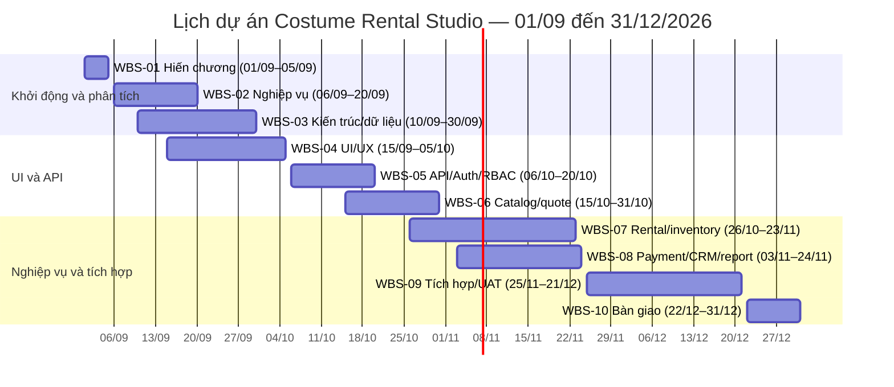
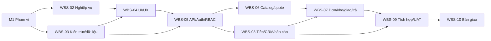

# WBS và lịch dự án — Studio cho thuê trang phục

**Baseline:** 01/09/2026–31/12/2026  
**Cách biểu diễn:** tài liệu Markdown để duyệt và đồng bộ thành Epic/Task/Sub-task trên Jira. Không dùng bảng tính Excel. Ngày bắt đầu/kết thúc là ngày lịch, bao gồm cả hai đầu mốc. Ngày tháng 9 là kế hoạch gốc và cần cập nhật trạng thái thực tế vì thời điểm lập lại là 05/10/2026.

Hiến chương và phạm vi cấp cao nằm trong [Hiến chương dự án](Hi%E1%BA%BFn%20ch%C6%B0%C6%A1ng%20d%E1%BB%B1%20%C3%A1n%20studio%20cho%20thu%C3%AA%20trang%20ph%E1%BB%A5c.md). Nghiệp vụ chi tiết đối chiếu với [quy tắc nghiệp vụ hiện hành](business-rules.md).

## 1. Cấu trúc Jira và quan hệ công việc

- Mỗi nhóm `WBS-01`…`WBS-10` là một **Epic**.
- Các dòng công việc cấp dưới là **Task/Story** nằm trong Epic bằng trường `Parent`.
- Các cặp công việc có quan hệ trước/sau phải thêm Issue Link Jira: công việc sau **is blocked by** công việc trước; chiều ngược lại công việc trước **blocks** công việc sau.
- M1…M10 là mốc nghiệm thu, có thể tạo issue loại Milestone nếu project Jira có loại này; nếu không, dùng Task gắn nhãn `milestone`.
- Gán Jira Start date và Due date theo hai cột ngày của bảng. Không suy ngày kết thúc chỉ từ số tuần của Gantt.
- `WBS-ID` là mã tham chiếu để tạo ticket, không phải Jira issue key. Owner chưa được tự đặt vì nhóm chưa cung cấp danh sách thành viên.

## 2. Danh sách công việc và quan hệ phụ thuộc

| WBS-ID | Jira type | Công việc/đầu ra nghiệm thu | Bắt đầu | Kết thúc | Quan hệ trước/sau |
|---|---|---|---:|---:|---|
| WBS-01 | Epic | Khởi động và quản trị — baseline hiến chương, stakeholder, quyết định, tiêu chí duyệt | 01/09/2026 | 05/09/2026 | — |
| 1.1 | Task | Xác định người duyệt nghiệp vụ, PM, kỹ thuật; lập kênh quyết định và họp tuần | 01/09/2026 | 02/09/2026 | — |
| 1.2 | Task | Duyệt hiến chương: mục tiêu, phạm vi, ngoài phạm vi, tiêu chí nghiệm thu | 01/09/2026 | 05/09/2026 | Chạy song song với 1.1; không tạo link chặn |
| M1 | Milestone | Hiến chương và baseline phạm vi được duyệt | 05/09/2026 | 05/09/2026 | 1.2 FS |
| WBS-02 | Epic | Phân tích nghiệp vụ — quy trình, ngoại lệ, yêu cầu và tiêu chí nghiệm thu | 06/09/2026 | 20/09/2026 | Xem phụ thuộc ở các task con |
| 2.1 | Task | Chốt luồng catalog → yêu cầu → duyệt → giao/thu → trả/quyết toán | 06/09/2026 | 12/09/2026 | M1 FS |
| 2.2 | Task | Chốt vai trò/quyền chi nhánh, trạng thái đơn/bộ, quy tắc tiền và CRM | 08/09/2026 | 16/09/2026 | Chạy song song với 2.1; không tạo link chặn |
| 2.3 | Task | Viết use case, ngoại lệ, tiêu chí nghiệm thu và liên kết yêu cầu | 17/09/2026 | 19/09/2026 | 2.1 FS; 2.2 FS |
| M2 | Milestone | Yêu cầu nghiệp vụ và tiêu chí nghiệm thu được duyệt | 20/09/2026 | 20/09/2026 | 2.3 FS |
| WBS-03 | Epic | Kiến trúc và dữ liệu — thiết kế FE/BE, ERD, migration/seed | 10/09/2026 | 30/09/2026 | Xem phụ thuộc ở các task con |
| 3.1 | Task | Chốt kiến trúc React/Vite, Express API, PostgreSQL/Prisma và phân ranh module | 10/09/2026 | 16/09/2026 | M1 FS |
| 3.2 | Task | Hoàn thiện ERD, ràng buộc dữ liệu, trạng thái giao dịch, quyền và nhật ký | 17/09/2026 | 25/09/2026 | 3.1 FS; 2.2 FS |
| 3.3 | Task | Rà soát schema/migration/seed và hướng dẫn khởi chạy môi trường dev | 26/09/2026 | 30/09/2026 | 3.2 FS |
| M3 | Milestone | Kiến trúc và nền dữ liệu được review | 30/09/2026 | 30/09/2026 | 3.3 FS |
| WBS-04 | Epic | UI/UX — design system, đầy đủ màn fixture, audit responsive và accessibility | 15/09/2026 | 05/10/2026 | Xem phụ thuộc ở các task con |
| 4.1 | Task | Hoàn thiện token, component, shell khách và shell vận hành | 15/09/2026 | 21/09/2026 | M1 FS; triển khai song song với 2.2 và 3.1 |
| 4.2 | Story | Hoàn thiện catalog, chi tiết, yêu cầu thuê và đơn của khách bằng fixture | 21/09/2026 | 28/09/2026 | 4.1 FS |
| 4.3 | Story | Hoàn thiện bảng việc, đơn, giao/trả, quầy, kho, CRM, nhân sự và quyền bằng fixture | 24/09/2026 | 02/10/2026 | 4.1 FS |
| 4.4 | Task | Audit mười hành trình, lỗi/xung đột, responsive, focus và tự động accessibility | 03/10/2026 | 05/10/2026 | 4.2 FS; 4.3 FS |
| M4 | Milestone | Bản UI/UX fixture nghiệm thu nội bộ | 05/10/2026 | 05/10/2026 | 4.4 FS |
| WBS-05 | Epic | API nền, đăng nhập và phân quyền theo chi nhánh | 06/10/2026 | 20/10/2026 | Xem phụ thuộc ở các task con |
| 5.1 | Task | Chốt API contract, envelope lỗi, version/idempotency và phân trang | 06/10/2026 | 10/10/2026 | M3 FS |
| 5.2 | Story | Tạo phiên đăng nhập Google, hồ sơ nội bộ, trạng thái tài khoản và đăng xuất | 08/10/2026 | 16/10/2026 | Song song với 5.1; bắt đầu dùng bản contract đang soạn |
| 5.3 | Story | Áp vai trò/quyền, chi nhánh, kiểm tra quyền ở API và nhật ký thay đổi | 17/10/2026 | 20/10/2026 | 5.1 FS; 5.2 FS |
| M5 | Milestone | API nền và kiểm quyền có thể demo | 20/10/2026 | 20/10/2026 | 5.2 FS; 5.3 FS |
| WBS-06 | Epic | Danh mục, khả dụng và báo giá | 15/10/2026 | 31/10/2026 | Xem phụ thuộc ở các task con |
| 6.1 | Story | API mẫu/biến thể/ảnh và lọc catalog theo dữ liệu công khai | 15/10/2026 | 22/10/2026 | 5.1 FS; 3.3 FS |
| 6.2 | Story | API kiểm tra bộ theo chi nhánh/kỳ, block và báo giá snapshot | 23/10/2026 | 27/10/2026 | 6.1 FS; 5.3 FS |
| 6.3 | Story | Nối catalog, lịch, chi tiết và báo giá UI với API | 28/10/2026 | 31/10/2026 | 6.1 FS; 6.2 FS; 5.2 FS |
| M6 | Milestone | Khách tìm mẫu và nhận báo giá từ API | 31/10/2026 | 31/10/2026 | 6.3 FS |
| WBS-07 | Epic | Đơn thuê, kho, giao/đang thuê/trả | 26/10/2026 | 23/11/2026 | Xem phụ thuộc ở các task con |
| 7.1 | Story | API tạo/duyệt/từ chối/hủy đơn, version và gán barcode nguyên tử | 28/10/2026 | 05/11/2026 | 5.3 FS; 6.2 FS |
| 7.2 | Story | API kho, block vệ sinh/sửa, điều chuyển, xuất/nhận và lịch sử bộ | 26/10/2026 | 07/11/2026 | 5.3 FS; 3.3 FS |
| 7.3 | Story | API biên bản giao, thu trạng thái thuê/cọc và tra cứu người đang giữ barcode | 13/11/2026 | 19/11/2026 | 7.1 FS; 7.2 FS; 8.1 FS |
| 7.4 | Story | API trả từng bộ, nhận một phần, ghi tình trạng và lập snapshot quyết toán | 20/11/2026 | 23/11/2026 | 7.3 FS; 8.3 FS |
| M7 | Milestone | Nhân viên demo được luồng đơn–giao–đang thuê–trả | 23/11/2026 | 23/11/2026 | 7.4 FS |
| WBS-08 | Epic | Thanh toán, CRM và báo cáo MVP | 03/11/2026 | 24/11/2026 | Xem phụ thuộc ở các task con |
| 8.1 | Story | Ghi nhận tiền mặt/chuyển khoản thủ công, khoản thuê/cọc và đối chiếu | 03/11/2026 | 12/11/2026 | 5.1 FS; 5.3 FS |
| 8.2 | Task | D-1: Đại diện nghiệp vụ chốt quy tắc hoàn cọc/đối soát, trạng thái chờ/lỗi và cách chống hoàn trùng | 03/11/2026 | 12/11/2026 | M2 FS |
| 8.3 | Story | API quyết toán, cấn trừ và ghi nhận hoàn theo chính sách đã duyệt | 13/11/2026 | 19/11/2026 | 8.1 FS; 8.2 FS |
| 8.4 | Story | API hồ sơ khách, lịch sử, tương tác và case CRM theo chi nhánh | 12/11/2026 | 20/11/2026 | 5.3 FS; 3.3 FS |
| 8.5 | Story | Báo cáo đơn/doanh thu/cọc/đang thuê theo quyền và chi nhánh | 17/11/2026 | 24/11/2026 | 7.1 FS; 8.1 FS; 5.3 FS |
| M8 | Milestone | CRM, báo cáo và tiền MVP có thể demo | 24/11/2026 | 24/11/2026 | 8.3 FS; 8.4 FS; 8.5 FS |
| WBS-09 | Epic | Tích hợp, kiểm thử hồi quy và UAT | 25/11/2026 | 21/12/2026 | Xem phụ thuộc ở các task con |
| 9.1 | Task | Nối các màn UI fixture với API hoàn chỉnh theo từng hành trình | 25/11/2026 | 02/12/2026 | M7 FS; M8 FS |
| 9.2 | Task | Kiểm thử tích hợp và hồi quy: quyền, cạnh tranh barcode, tiền, lỗi/mạng | 03/12/2026 | 12/12/2026 | 9.1 FS |
| 9.3 | Task | UAT tại kịch bản online/quầy/giao/trả; sửa lỗi P0/P1 và nghiệm thu | 13/12/2026 | 21/12/2026 | 9.2 FS |
| M9 | Milestone | Nghiệm thu người dùng hoàn thành | 21/12/2026 | 21/12/2026 | 9.3 FS |
| WBS-10 | Epic | Tài liệu, demo và bàn giao | 22/12/2026 | 31/12/2026 | Xem phụ thuộc ở các task con |
| 10.1 | Task | Hoàn thiện hướng dẫn cài đặt, vận hành, dữ liệu demo, giới hạn và hỗ trợ | 22/12/2026 | 27/12/2026 | M9 FS |
| 10.2 | Task | Chuẩn bị bản phát hành/demo, rà cấu hình môi trường và biên bản bàn giao | 28/12/2026 | 31/12/2026 | 10.1 FS |
| M10 | Milestone | Bàn giao dự án | 31/12/2026 | 31/12/2026 | 10.2 FS |

`FS` = công việc trước phải kết thúc trước khi công việc sau bắt đầu. Chỉ các quan hệ `FS` là dependency Jira và phải được nối bằng Issue Link: công việc sau **is blocked by** công việc trước. Các công việc được ghi “chạy song song” vẫn giữ lịch riêng, không tạo link chặn sai thứ tự.

## 3. Gantt chart có ngày bắt đầu và kết thúc

Bảng thể hiện lịch tháng theo tuần; ngày chính xác của từng việc nằm ở cột Bắt đầu/Kết thúc trong WBS. Thanh `■` cho biết công việc có hoạt động trong tuần tương ứng. Tuần có thể cắt qua tháng; ngày thực tế vẫn theo hai cột ngày.

| WBS | Công việc | Bắt đầu | Kết thúc | 01–07/09 | 08–14/09 | 15–21/09 | 22–30/09 | 01–07/10 | 08–14/10 | 15–21/10 | 22–31/10 | 01–07/11 | 08–14/11 | 15–21/11 | 22–30/11 | 01–07/12 | 08–14/12 | 15–21/12 | 22–31/12 |
|---|---|---:|---:|:---:|:---:|:---:|:---:|:---:|:---:|:---:|:---:|:---:|:---:|:---:|:---:|:---:|:---:|:---:|:---:|
| WBS-01 | Khởi động/hiến chương | 01/09 | 05/09 | ■ | | | | | | | | | | | | | | | |
| WBS-02 | Phân tích nghiệp vụ | 06/09 | 20/09 | ■ | ■ | ■ | | | | | | | | | | | | | |
| WBS-03 | Kiến trúc và dữ liệu | 10/09 | 30/09 | | ■ | ■ | ■ | | | | | | | | | | | | |
| WBS-04 | UI/UX fixture và audit | 15/09 | 05/10 | | | ■ | ■ | ■ | | | | | | | | | | | |
| WBS-05 | API nền, Google login, RBAC | 06/10 | 20/10 | | | | | ■ | ■ | ■ | | | | | | | | | |
| WBS-06 | Catalog, khả dụng, báo giá | 15/10 | 31/10 | | | | | | | ■ | ■ | | | | | | | | |
| WBS-07 | Đơn, kho, giao và trả | 26/10 | 23/11 | | | | | | | ■ | ■ | ■ | ■ | ■ | | | | | |
| WBS-08 | Thanh toán, CRM, báo cáo | 03/11 | 24/11 | | | | | | | | | ■ | ■ | ■ | ■ | | | | |
| WBS-09 | Tích hợp, regression, UAT | 25/11 | 21/12 | | | | | | | | | | | ■ | ■ | ■ | ■ | ■ | |
| WBS-10 | Tài liệu và bàn giao | 22/12 | 31/12 | | | | | | | | | | | | | | | | ■ |

### Sơ đồ Gantt ngày chính

## 4. Quan hệ và đường găng

Chuỗi phụ thuộc quan trọng để Jira hiển thị `blocks / is blocked by`:

Đường cần theo dõi sát: `M1 → WBS-02/WBS-03 → WBS-05 → WBS-06 → WBS-07/WBS-08 → WBS-09 → WBS-10`. Chậm ở chính sách hoàn cọc hoặc API phân quyền có thể làm trượt UAT. Jira cần giữ quan hệ cấp Epic và dependency issue links; WBS-ID trong tài liệu là khóa đối chiếu để tạo link đúng.

## 5. Ràng buộc trước khi tạo ticket Jira

- Project key/board, timezone Jira và phiên bản issue type cần được lấy từ workspace Jira đang kết nối.
- Jira Start date và Due date sẽ dùng ngày ở bảng; nếu Jira cấu hình timezone khác, hiển thị ngày địa phương nhưng giữ ngày lịch Việt Nam.
- Owner, sprint/iteration và effort chưa có dữ liệu để gán; không tự gán người hoặc ước lượng story points.
- `D-1` là quyết định nghiệp vụ về cách hoàn/đối soát cọc. Gắn ticket quyết định này làm dependency cho `8.3` và `7.4`; nếu chưa chốt trước 07/11/2026, ghi rõ phạm vi phần hoàn ở UAT và đẩy mốc liên quan sau khi nhóm duyệt.
- Trước khi tạo thật, tạo Epics theo WBS-01…10, tạo task con theo ID, áp start/due date, sau đó thêm issue links. Không tạo file Excel làm bản thay thế cho Jira.
