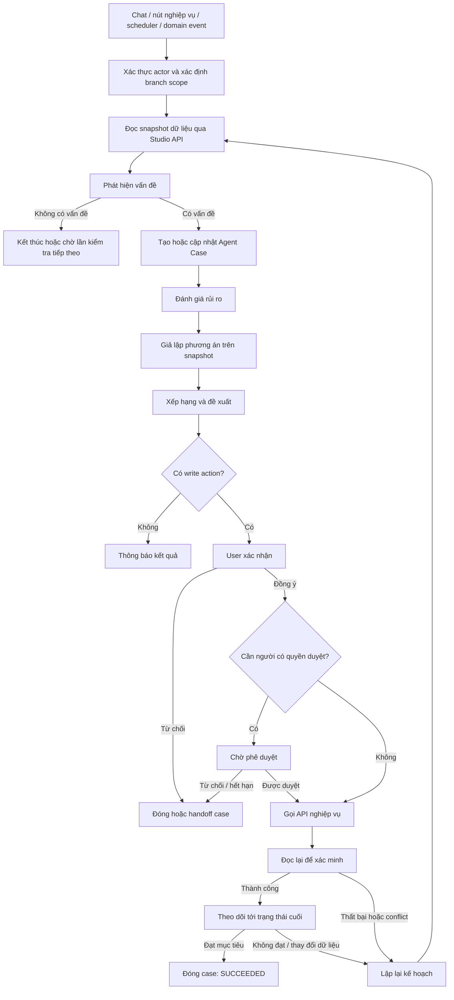

# Vòng đời Operations Agent

## 1. Tổng quan

Operations Agent hỗ trợ xử lý ngoại lệ trong vận hành cho thuê trang phục. Agent không chỉ trả lời hội thoại mà vận hành theo một vòng đời gồm sáu capability chính:

1. Phát hiện vấn đề.
2. Đánh giá hoặc dự đoán rủi ro.
3. Giả lập các phương án xử lý.
4. Đề xuất phương án phù hợp.
5. Thực thi hành động đã được xác nhận hoặc phê duyệt.
6. Theo dõi kết quả và lập lại kế hoạch khi cần.

Chat, nút thao tác trên giao diện, job định kỳ và sự kiện nghiệp vụ chỉ là các cách khác nhau để khởi động cùng một vòng đời này.

Agent không thay thế các API nghiệp vụ của Studio. Mọi dữ liệu live phải được đọc và thay đổi thông qua API NestJS có xác thực, phân quyền và kiểm tra ràng buộc.

## 2. Phạm vi

### Trong phạm vi

- Phát hiện đơn trùng lịch, thiếu thời gian vệ sinh, trả trễ và nguy cơ thiếu năng lực xử lý.
- Đánh giá nguy cơ giao trễ hoặc trang phục không kịp sẵn sàng.
- Giả lập đổi bộ, chuyển chi nhánh hoặc thay đổi thứ tự ưu tiên vệ sinh.
- So sánh phương án theo thời gian, chi phí, rủi ro và trải nghiệm khách hàng.
- Tạo đề xuất có bằng chứng, yêu cầu xác nhận/phê duyệt và gọi API thực thi.
- Đọc lại trạng thái, theo dõi tới kết quả cuối và lập lại kế hoạch khi thất bại.

### Ngoài phạm vi tự động hoàn toàn

- Tự thay đổi chính sách giá, phí, cọc hoặc hoàn tiền.
- Tự ghi nhận giao/nhận trang phục khi chưa có bằng chứng thực tế.
- Tự bỏ qua xung đột lịch hoặc trạng thái vật lý của costume unit.
- Tự mở rộng hành động đã được duyệt sang record hoặc mục tiêu khác.
- Tự giả định dữ liệu còn thiếu là hợp lệ.

## 3. Luồng tổng thể



### Hai cách kích hoạt

| Cách kích hoạt | Ví dụ | Hành vi |
| --- | --- | --- |
| Theo yêu cầu | Nhân viên hỏi “Kiểm tra các đơn có nguy cơ trễ ngày mai” | Tạo hoặc tiếp tục case từ message của người dùng |
| Chủ động | Scheduler chạy định kỳ hoặc nhận event trả trễ | Đọc dữ liệu, phát hiện rủi ro, chống tạo case trùng và gửi thông báo |

Job nền chỉ được tự động đọc, đánh giá, giả lập và thông báo. Hành động ghi phải đi qua confirmation/approval tương ứng.

## 4. Sáu capability nghiệp vụ

### 4.1 Phát hiện

Mục tiêu là xác định một tình huống vận hành cần xử lý dựa trên dữ liệu và rule xác định, không dựa trên suy đoán tự do của LLM.

| Loại phát hiện | Dữ liệu tối thiểu | Rule khái quát | Người xử lý chính |
| --- | --- | --- | --- |
| Đơn trùng lịch | allocation, khoảng chiếm dụng, unit block, trạng thái đơn | Cùng một unit có hai khoảng thời gian bảo vệ giao nhau | Nhân viên kho, nhân viên quầy |
| Thiếu thời gian vệ sinh | hạn trả, buffer trả trễ, cleaning buffer, giờ nhận tiếp theo | `due + late buffer + cleaning buffer > next pickup` | Nhân viên kho |
| Trả trễ | trạng thái đơn, hạn trả, thời điểm hiện tại | Đơn vẫn đang active sau hạn trả | Nhân viên quầy |
| Trang phục chưa sẵn sàng | trạng thái vật lý, block vệ sinh/sửa chữa, giờ nhận | Unit không thể về `READY` trước giờ nhận | Nhân viên kho |
| Thiếu nhân sự | workload, task, ca làm và năng lực theo loại việc | Khối lượng cần hoàn thành vượt năng lực trước deadline | Quản lý chi nhánh |

Đầu ra phát hiện phải có:

- mã rule và phiên bản rule;
- thời điểm đánh giá;
- record liên quan;
- dữ liệu đầu vào quan trọng;
- mức độ ban đầu;
- bằng chứng hoặc reference;
- trạng thái `UNKNOWN` khi dữ liệu không đủ.

Không thêm trạng thái `AT_RISK` vào state machine của đơn. Rủi ro được lưu trong Agent Case hoặc operational task riêng để không làm sai trạng thái nghiệp vụ gốc.

### 4.2 Đánh giá và dự đoán

Giai đoạn đầu dùng **rule-based risk score**, chưa gọi là mô hình dự đoán Machine Learning.

Ví dụ đầu ra:

```json
{
  "riskLevel": "HIGH",
  "riskScore": 82,
  "estimatedDelayMinutes": 150,
  "reasons": [
    "Trang phục chưa được trả",
    "Cần 180 phút để vệ sinh",
    "Đơn tiếp theo nhận sau 120 phút"
  ],
  "ruleVersion": "readiness-risk-v1",
  "evaluatedAt": "2026-10-16T09:00:00+07:00"
}
```

Chỉ chuyển sang xác suất dự đoán khi có:

- dữ liệu lịch sử đủ chất lượng;
- định nghĩa nhãn thành công/thất bại;
- baseline để so sánh;
- phiên bản model;
- chỉ số đánh giá và ngưỡng được phê duyệt;
- cơ chế theo dõi drift và hiệu chỉnh.

### 4.3 Giả lập

Simulation chạy trên snapshot đã đọc và không được ghi vào hệ thống thật.

Các phương án MVP:

1. Đổi sang costume unit khác cùng variant/size và đúng chi nhánh.
2. Đổi sang mẫu tương đương khi khách đồng ý.
3. Ưu tiên vệ sinh hoặc sửa chữa.
4. Chuyển unit từ chi nhánh khác.
5. Thương lượng đổi giờ/ngày nhận khi không còn phương án vật lý phù hợp.

Mỗi kết quả giả lập phải nêu:

- giả định đầu vào;
- thay đổi dự kiến;
- thời điểm dự kiến hoàn tất;
- chi phí dự kiến;
- đơn hoặc khách hàng bị ảnh hưởng;
- ràng buộc đạt/không đạt;
- write action cần thiết nếu chọn phương án.

### 4.4 Đề xuất

Agent loại bỏ phương án vi phạm ràng buộc cứng trước khi xếp hạng. Ví dụ: không được lấy unit vẫn đang ở khách hoặc unit đã được giữ cho một đơn khác.

Công thức điểm có thể bắt đầu bằng rule có cấu hình:

```text
totalScore =
    onTimeScore
  - costPenalty
  - operationalRiskPenalty
  - affectedOrdersPenalty
  + customerExperienceScore
```

Đầu ra cho người dùng phải hiển thị:

- vấn đề và bằng chứng;
- phương án được đề xuất;
- so sánh trước/sau;
- chi phí, rủi ro và ảnh hưởng;
- các phương án thay thế;
- action cụ thể sẽ được gọi;
- lý do cần confirmation hoặc approval;
- thời hạn của đề xuất.

### 4.5 Thực thi có giám sát

Agent không sửa trực tiếp database nghiệp vụ. Sau khi được xác nhận/phê duyệt, AI service gọi tool; tool gọi API nội bộ NestJS; NestJS mới là nơi quyết định cuối cùng.

Các nhóm hành động:

| Nghiệp vụ | Ví dụ tool/API | Quyền hiện tại | Cổng an toàn |
| --- | --- | --- | --- |
| Giữ bộ, vệ sinh, sửa chữa | create/update/cancel unit block | `inventory:manage` | Confirmation |
| Đổi bộ, gia hạn, hủy đơn | reallocate/extend/cancel rental | `rentals:manage` | Confirmation + expected version |
| Tạo chuyển kho | create stock transfer | `transfers:manage` | Confirmation |
| Duyệt/từ chối chuyển kho | approve/reject stock transfer | `transfers:manage` | Approval + expected version |
| Checkout/refund | create checkout/request refund | `payments:manage` | Confirmation + approval |
| Tạo operational task | Chưa có tool chính thức | Cần thiết kế `tasks:*` | Tùy loại task và mức tác động |

NestJS phải kiểm tra lại:

- danh tính actor từ token tin cậy;
- permission và branch scope;
- schema và business rule;
- feature flag;
- expected version khi record có thể thay đổi đồng thời;
- idempotency key với thao tác có nguy cơ gửi trùng;
- confirmation/approval còn hiệu lực và đúng action snapshot.

### 4.6 Theo dõi và lập lại kế hoạch

HTTP `2xx` hoặc câu trả lời của model không đủ để kết luận thành công. Agent phải đọc lại record bằng read tool phù hợp và so sánh với completion criteria.

Sau read-back:

- đạt mục tiêu: chuyển case sang `SUCCEEDED`;
- cần chờ trạng thái cuối: chuyển sang `MONITORING`;
- version conflict hoặc phương án không còn khả thi: đọc snapshot mới và lập lại kế hoạch;
- thiếu quyền, thiếu dữ liệu hoặc hết phương án an toàn: `HANDED_OFF` hoặc `INSUFFICIENT_DATA`;
- outcome của write không xác định: không tự retry mù, phải tra cứu bằng idempotency key hoặc handoff.

Replan được phép thay đổi bước đọc, phân tích và simulation. Agent không được tự lặp lại write action hoặc mở rộng phạm vi ngoài phần người dùng đã duyệt.

## 5. Role và phạm vi quyền

### Role hiện có

| Role | Vai trò trong vòng đời Agent |
| --- | --- |
| `SALES_STAFF` | Xem rủi ro đơn trong chi nhánh, xử lý trả trễ, trao đổi với khách, xác nhận đổi unit/gia hạn/hủy đơn trong quyền được cấp |
| `INVENTORY_STAFF` | Xem lịch unit, phát hiện vấn đề sẵn sàng, quản lý block vệ sinh/sửa chữa và tạo/xử lý chuyển kho trong quyền được cấp |
| `ADMIN` | Quan sát toàn hệ thống và thực hiện nghiệp vụ phạm vi `ALL`; hiện đang phải kiêm một phần vai trò quản lý |
| `CUSTOMER` | Chỉ xem và quản lý đơn thuộc phạm vi `OWN`; không được xem cảnh báo nội bộ hoặc thực thi nghiệp vụ kho |

Role chỉ là cách gom permission. Quyết định cuối cùng phải dựa trên `module:action`, branch scope và target record, không dựa riêng vào tên role.

### Role nên bổ sung

Nên bổ sung `BRANCH_MANAGER` để tách quản lý nghiệp vụ khỏi `ADMIN`. Role này chịu trách nhiệm:

- xem tất cả cảnh báo trong chi nhánh;
- chạy hoặc xem simulation;
- duyệt chuyển kho và hành động có chi phí/tác động cao;
- xem báo cáo hiệu quả;
- không quản trị RBAC hoặc cấu hình toàn hệ thống.

Nên tách quyền tạo/xử lý khỏi quyền duyệt, ví dụ `transfers:manage` và `transfers:approve`, thay vì dùng chung một quyền cho cả hai.

## 6. Agent Case và state machine

Case là trạng thái nghiệp vụ dài hạn của Agent, tách khỏi history chat. Một case có thể tồn tại qua nhiều message, job và lần phê duyệt.

```text
NEW
  → ANALYZING
  → PLAN_READY
  → WAITING_INPUT | WAITING_CONFIRMATION | WAITING_APPROVAL
  → EXECUTING
  → MONITORING
  → SUCCEEDED
```

Các trạng thái kết thúc hoặc handoff khác:

- `INSUFFICIENT_DATA`
- `HANDED_OFF`
- `FAILED`
- `CANCELLED`

Case tối thiểu cần lưu:

- goal và completion criteria;
- actor, role, branch scope;
- entity liên quan;
- snapshot/evidence và freshness;
- risk finding;
- các phương án simulation;
- recommendation được chọn;
- confirmation/approval snapshot;
- tool executions và read-back;
- deadline theo dõi;
- termination reason và handoff context.

### 6.1 Case khách đã thử đồ và đặt lịch nhận sau

Khi khách đến studio thử, chọn một bộ cụ thể và đặt lịch nhận trong tương lai, đơn đã xác nhận có thể giữ chính xác costume unit/barcode khách đã chọn. Trong khoảng trước giờ nhận, unit đó vẫn có thể thuộc một đơn thuê trước nếu các khoảng bảo vệ không giao nhau.

Không tạo Agent Case cho mọi đơn đặt trước. Case chỉ được tạo khi scheduler hoặc domain event phát hiện unit có nguy cơ không sẵn sàng đúng giờ. Với tình huống khách A đang giữ unit và khách B là người nhận kế tiếp, case cần lưu tối thiểu:

- `primaryEntityId`: đơn B cần được bảo vệ giờ nhận;
- `affectedEntityId`: đơn A đang giữ unit;
- unit/barcode, variant, size và branch liên quan;
- `plannedDueAt` của A, `pickupAt` của B và thời gian chuẩn bị bắt buộc;
- trạng thái allocation thực tế của A và trạng thái vật lý của unit;
- thời điểm kiểm tra tiếp theo và hạn cuối phải có quyết định;
- các phương án đã giả lập, recommendation hiện hành và version của snapshot;
- confirmation/approval gắn đúng action, unit thay thế, đơn bị tác động và thời hạn hiệu lực.

Goal mẫu của case:

```text
Đảm bảo đơn B có một unit hợp lệ và sẵn sàng trước pickupAt,
không giao unit vẫn ở khách A và không tự thay đổi lựa chọn của khách B.
```

Completion criteria:

- unit ban đầu đã được nhận lại, hoàn tất các bước chuẩn bị và ở trạng thái `READY`; hoặc
- đơn B đã được phân công sang unit thay thế hợp lệ sau khi có confirmation/approval cần thiết; hoặc
- phương án đổi giờ, đổi mẫu, hủy/refund đã được người có thẩm quyền và khách hàng liên quan chấp thuận, rồi được ghi nhận qua API nghiệp vụ.

Nếu dữ liệu thay đổi sau khi đã đề xuất, Agent phải vô hiệu hóa confirmation cũ, đọc snapshot mới và lập lại phương án. Không được dùng confirmation cho một unit hoặc thời gian khác với action snapshot mà người dùng đã xác nhận.

## 7. Job nền, event và notification

### Job định kỳ

Scheduler phù hợp với tình huống phụ thuộc thời gian:

- quét đơn sắp nhận/trả;
- phát hiện đơn quá hạn;
- kiểm tra costume unit chưa sẵn sàng trước deadline;
- kiểm tra case đang `MONITORING`.

Với đơn đã thử đồ và đặt trước, scheduler nên tái đánh giá ở các mốc cấu hình được, ví dụ `T-24h`, `T-6h` và `T-2h` trước giờ nhận. Mỗi lần đánh giá phải dùng trạng thái live, không suy ra rằng unit đã được trả chỉ vì `plannedDueAt` hoặc buffer đã hết.

Rule khởi điểm:

```text
RISK nếu:
  allocation của đơn trước vẫn ACTIVE
  và now + thời_gian_chuẩn_bị_tối_thiểu > pickupAt của đơn kế tiếp
```

Rule cũng có thể phát hiện sớm hơn khi `plannedDueAt + late return buffer + cleaning buffer > pickupAt`, kể cả trước khi đơn trước thực sự quá hạn.

### Domain event

Event phù hợp với thay đổi cần phản ứng ngay:

- đơn được xác nhận hoặc đổi lịch;
- khách xác nhận lựa chọn sau khi thử đồ;
- đơn trước được gia hạn hoặc đã quá hạn nhưng allocation vẫn `ACTIVE`;
- costume unit được gán lại;
- khách trả đồ;
- unit block được tạo, hoàn tất hoặc hủy;
- stock transfer đổi trạng thái;
- task thất bại hoặc quá hạn.

### Chống thông báo trùng

Mỗi finding cần khóa logic dạng:

```text
ruleCode + primaryEntityId + affectedEntityId + timeWindow
```

Nếu finding cũ còn mở thì cập nhật case hiện tại, không tạo case và notification mới. Khi dữ liệu thay đổi đáng kể, tăng case version và vô hiệu hóa recommendation/approval snapshot cũ.

Notification phải gửi đúng role và branch, có severity, deadline, liên kết tới case và hành động tiếp theo. Notification không thay thế Agent Case và không phải nguồn trạng thái chính.

### Detection hiện hành

Worker chạy hoàn toàn deterministic trong Studio API, không gọi LLM, và quét các đơn `CONFIRMED`, `PREPARING` hoặc `READY_FOR_PICKUP` sắp nhận trong cửa sổ cấu hình.

Sáu rule đang được hỗ trợ; ba rule đầu bảo vệ readiness của đơn sắp nhận, rule thứ tư theo dõi đơn đang thuê quá hạn, rule thứ năm theo dõi năng lực xử lý đã khai báo của chi nhánh và rule thứ sáu phát hiện dữ liệu lịch dùng chung một unit bị chồng lấp:

- `PREVIOUS_RENTAL_NOT_RETURNED/v1`: order khác vẫn giữ allocation `ACTIVE` và thời gian hiện tại cộng cleaning buffer đã vượt quá giờ nhận của đơn kế tiếp.
- `ALLOCATED_UNIT_NOT_READY/v1`: unit đã gán cho đơn sắp nhận đang sai chi nhánh, có transfer đang hoạt động, có block kéo dài qua giờ nhận, hoặc không có lịch xác định để chuyển từ trạng thái `CLEANING/REPAIR/...` về `READY` trước giờ nhận.
- `ORDER_PREPARATION_DELAYED/v1`: đơn còn `CONFIRMED/PREPARING` trong hai giờ trước giờ nhận dù mọi item đã được phân bổ và mọi unit đều `READY` tại đúng chi nhánh, không có active rental, block hoặc transfer.
- `RENTAL_RETURN_OVERDUE/v1`: đơn `ACTIVE` đã qua `plannedDueAt + lateGraceMinutes` và vẫn còn ít nhất một allocation `ACTIVE`.
- `OPERATIONAL_CAPACITY_SHORTFALL/v1`: tổng effort còn lại của các unit block được gán vào một capacity window lớn hơn số phút công còn lại của window tại thời điểm quan sát.
- `UNIT_SCHEDULE_CONFLICT/v1`: hai order chưa kết thúc cùng giữ một physical unit với các khoảng `occupiedFrom`–`occupiedUntil` giao nhau. Unit này là rule phòng vệ cho dữ liệu legacy/import hoặc race condition; API confirm/reallocate/extend vẫn là guard đồng bộ chính. Đơn bắt đầu sau được đề xuất đổi sang unit cùng variant sau confirmation; không có phương án thì handoff thủ công.

`ORDER_PREPARATION_DELAYED` loại trừ hai rule unit-level. Nếu khách trước còn giữ bất kỳ unit nào thì `PREVIOUS_RENTAL_NOT_RETURNED` được ưu tiên; nếu unit sai chi nhánh hoặc chưa sẵn sàng thì `ALLOCATED_UNIT_NOT_READY` được ưu tiên. Một preparation-delay finding đang mở sẽ được resolve khi một trong hai rủi ro unit-level xuất hiện, nên nhân viên không phải xử lý hai case cùng nguyên nhân.

Analysis của preparation delay chỉ đề xuất `START_PREPARATION` hoặc `COMPLETE_PREPARATION`. Các option này được đánh dấu không executable: Agent không tự chuyển đơn sang `PREPARING` hoặc `READY_FOR_PICKUP` vì hệ thống chưa có checklist xác minh việc đóng gói, phụ kiện và kiểm tra bàn giao đã hoàn tất.

### Overdue rental return

Worker riêng phát hiện `RENTAL_RETURN_OVERDUE/v1` khi order vẫn `ACTIVE`, đã qua `plannedDueAt + lateGraceMinutes` và còn ít nhất một item có allocation `ACTIVE`. Finding ở cấp order, dùng `caseType = RENTAL_RETURN`, thuộc pickup branch và không chứa PII khách hàng.

Rule này bị suppress khi chính các unit chưa trả đang tạo `PREVIOUS_RENTAL_NOT_RETURNED` cho một đơn sắp nhận. Case 1 khi đó ưu tiên bảo vệ đơn kế tiếp. Nếu xung đột downstream biến mất nhưng order nguồn vẫn quá hạn, tick sau có thể tạo Case 4.

Analysis chỉ tạo hướng dẫn không executable: `CONTACT_CUSTOMER_FOR_RETURN`, hoặc ưu tiên `ESCALATE_OVERDUE_RETURN` khi đã quá hạn trên 24 giờ. Agent không tự liên hệ khách, gia hạn đơn, tính/thu phí hoặc thay đổi Rental Order. Finding được resolve khi không còn order/unit active hoặc một lần gia hạn hợp lệ đưa grace deadline về tương lai.

### Operational capacity shortfall

Case 5 dùng `caseType = OPERATIONAL_CAPACITY` và finding cấp branch. Scheduling API lưu các capacity window không chồng lấn gồm `startsAt`, `endsAt` và `availableMinutes`. Trường `availableMinutes` là tổng ngân sách phút công của toàn window, không phải số phút đồng hồ hay giá trị còn lại tại thời điểm đọc.

Mỗi `UnitBlock` có thể được gán rõ ràng vào một window bằng `capacityWindowId`. Block `PLANNED` đóng góp `estimatedEffortMinutes`; block `IN_PROGRESS` đóng góp `remainingEffortMinutes`; block `COMPLETED/CANCELLED` không đóng góp workload. `blockedFrom/blockedUntil` tiếp tục biểu diễn khoảng unit không khả dụng và không được dùng làm effort lao động.

Với window trong tương lai, detector dùng toàn bộ `availableMinutes`. Với window đang hoạt động, `remainingAvailableMinutes` được phân bổ theo tỷ lệ thời gian chưa trôi qua. Detector so sánh giá trị này với `remainingRequiredMinutes`; window đã kết thúc không tiếp tục tạo capacity finding.

Capacity window được quản lý qua `GET/POST /api/v1/scheduling/capacity-windows` và `PATCH/DELETE /api/v1/scheduling/capacity-windows/:capacityWindowId`, dùng cùng quyền `inventory:read/manage` và branch scope như unit block.

Capacity không được suy từ số nhân viên, role, giờ mở cửa hoặc thời lượng block. Nếu block `PLANNED` thiếu estimate hoặc block `IN_PROGRESS` thiếu remaining effort, worker không tạo shortfall finding vì dữ liệu chưa đủ để kết luận. Finding được resolve khi task hoàn tất/hủy, remaining effort giảm, capacity tăng, workload được chuyển khỏi window, window kết thúc hoặc window bị xóa.

Tổng effort, tổng task và số task thiếu effort được aggregate trực tiếp tại database. Finding và live context chỉ mang tối đa 100 dòng workload chi tiết, kèm `workloadCount`/`workloadTruncated`, để giữ payload và prompt có giới hạn mà không làm sai tổng workload.

Analysis chỉ đề xuất `REPRIORITIZE_OPERATIONAL_TASKS` hoặc `ESCALATE_CAPACITY_SHORTFALL`, đều không executable. Agent không tự phân công nhân viên, đổi ca, thay đổi block, điều chuyển unit, đổi đơn hoặc liên hệ khách.

Block vệ sinh hoặc sửa chữa có thời điểm kết thúc trước giờ nhận không tự tạo finding. Nếu tiến độ thực tế không hoàn tất, tick sau sẽ đánh giá lại trạng thái live và tạo finding khi unit không còn đường sẵn sàng đúng hạn.

Studio API chỉ đọc dữ liệu rental/inventory rồi gửi observation sang internal Finding API. AI service sở hữu finding và case, chống trùng bằng dedupe key gồm rule version, đơn kế tiếp, đơn hiện tại, unit và giờ nhận. Observation cũ hơn snapshot đã lưu bị bỏ qua để nhiều worker replica không ghi đè trạng thái mới.

Mỗi tick cũng tái đánh giá các finding đang mở. Khi khách trước đã trả, đơn kế tiếp đổi unit/lịch/branch, bị hủy hoặc không còn vi phạm buffer, finding chuyển `RESOLVED`; case chưa thực thi chuyển `SUCCEEDED`. Case đang `EXECUTING` không bị scheduler đóng giữa chừng và sẽ được kiểm tra lại ở tick sau.

Các cấu hình vận hành:

```text
AGENT_READINESS_DETECTION_ENABLED=false
AGENT_READINESS_INTERVAL_MS=60000
AGENT_READINESS_LOOKAHEAD_MINUTES=1440
AGENT_READINESS_BATCH_SIZE=100
AGENT_OVERDUE_RETURN_DETECTION_ENABLED=false
AGENT_OVERDUE_RETURN_INTERVAL_MS=60000
AGENT_OVERDUE_RETURN_BATCH_SIZE=100
AGENT_CAPACITY_DETECTION_ENABLED=false
AGENT_CAPACITY_INTERVAL_MS=60000
AGENT_CAPACITY_LOOKAHEAD_MINUTES=1440
AGENT_CAPACITY_BATCH_SIZE=100
```

Feature flag mặc định tắt để deploy migration và internal API trước khi kích hoạt worker. Detection không gọi LLM; analysis chỉ chạy khi nhân viên đã claim case và chủ động gọi Analyze. Notification và domain-event trigger vẫn chưa được triển khai.

Khi `BACKGROUND_WORKER_ENABLED=true`, API process khởi động cả năm detector; deployment có worker riêng phải đặt cờ này thành `false` trên API process và chạy `start:worker` để tránh nhân đôi scheduler.

## 8. Ví dụ end-to-end

### Tình huống

- Khách B đã đến studio thử, chọn `UNIT-001` và xác nhận lịch nhận lúc 17:00.
- Trước thời điểm đó, đơn A đang thuê `UNIT-001` và có hạn trả lúc 14:00.
- Late-return buffer là 60 phút.
- Cleaning buffer là 180 phút.

Thời điểm sớm nhất unit có thể sẵn sàng theo kế hoạch là 18:00, muộn hơn giờ nhận của đơn B một giờ.

### Xử lý

1. Khi đơn B được xác nhận, hệ thống kiểm tra khoảng bảo vệ và ghi nhận quan hệ unit với lịch A/B; chưa tự tạo case nếu chưa có rủi ro cần xử lý.
2. Scheduler đánh giá tại các mốc trước giờ nhận. Nếu A vẫn `ACTIVE` và không còn đủ thời gian chuẩn bị, scheduler tạo finding `INSUFFICIENT_TURNAROUND_TIME` hoặc `PREVIOUS_RENTAL_NOT_RETURNED`.
3. Agent tạo/cập nhật một case duy nhất cho cặp A/B, đánh giá rủi ro `HIGH` và đặt hạn xử lý trước giờ B nhận.
4. Agent đọc trạng thái live của A, B, unit, các unit thay thế, lịch chuyển kho và block hiện tại.
5. Agent giả lập mà không ghi dữ liệu thật:
   - ưu tiên vệ sinh: vẫn trễ một giờ;
   - đổi sang `UNIT-019`: đúng giờ, không phát sinh chi phí;
   - chuyển từ chi nhánh khác: đúng giờ, có chi phí và rủi ro vận chuyển.
6. Agent loại các phương án vi phạm ràng buộc rồi đề xuất đổi sang `UNIT-019`, hiển thị before/after, ảnh hưởng, chi phí và thời hạn của đề xuất.
7. Case chuyển `WAITING_CONFIRMATION`. `SALES_STAFF` xác nhận đúng action snapshot; nếu đổi mẫu, size, giá hoặc giờ nhận thì phải ghi nhận thêm sự đồng ý của khách và approval theo policy.
8. Agent gọi `reallocate_rental_item` kèm expected version và idempotency key.
9. Agent gọi `get_rental_order` để xác minh allocation mới rồi tiếp tục theo dõi đến khi unit thay thế thực sự `READY`.
10. Nếu đúng completion criteria, case chuyển `SUCCEEDED`.
11. Nếu `UNIT-019` vừa bị giữ bởi giao dịch khác, API trả version/conflict; Agent đọc lại dữ liệu, giả lập lại và yêu cầu confirmation mới.
12. Nếu không có phương án vật lý khả thi, case chuyển sang chờ quyết định của nhân viên/manager để liên hệ khách B; Agent không tự đổi lịch, hủy đơn, hoàn tiền hoặc chọn mức bồi hoàn.

Trong lúc case đang `MONITORING`, mỗi scheduler tick hoặc domain event có thể đưa case trở lại `ANALYZING`. Recommendation và confirmation cũ chỉ còn hiệu lực khi snapshot, target unit và action dự kiến không thay đổi.

## 9. Mức triển khai hiện tại

| Thành phần | Trạng thái trong codebase | Ghi chú |
| --- | --- | --- |
| Goal, skill, plan và giới hạn tool | Đã có nền tảng | Goal được gắn skill, workflow và allowlist tool |
| Vòng lặp read tool có điều kiện dừng | Đã có nền tảng | Có budget, loop/no-progress guard và termination reason |
| Confirmation/approval | Đã có nền tảng | Write proposal được đóng băng trước khi thực thi |
| Write tools và read-back | Đã có nền tảng | Phụ thuộc feature flag, quyền và API đích |
| Agent Case state | Đã có nền tảng | Có state cho analyzing, approval, executing, monitoring và terminal |
| Job nền tự phát hiện | Đã có bản deterministic đầu tiên | Polling theo lookahead, reconcile finding mở và retry ở tick sau khi dependency lỗi |
| Risk detection tổng hợp | Đã có sáu rule | `PREVIOUS_RENTAL_NOT_RETURNED/v1`, `ALLOCATED_UNIT_NOT_READY/v1`, `ORDER_PREPARATION_DELAYED/v1`, `RENTAL_RETURN_OVERDUE/v1`, `OPERATIONAL_CAPACITY_SHORTFALL/v1` và `UNIT_SCHEDULE_CONFLICT/v1` |
| Risk score/dự đoán | Chưa hoàn chỉnh | MVP nên bắt đầu bằng rule-based score |
| Simulation engine | Chưa hoàn chỉnh | Cần snapshot và evaluator không ghi dữ liệu thật |
| Recommendation ranking | Chưa hoàn chỉnh | Cần constraint filter và scoring config |
| Operational task API | Chưa có tool chính thức | Cần schema, permission và lifecycle task |
| Theo dõi dài hạn | Chưa hoàn chỉnh | Hiện tập trung read-back; cần scheduler/event để resume case |
| Phát hiện thiếu năng lực xử lý | Đã có MVP theo capacity khai báo | Chưa phải chấm công/ca làm/kỹ năng nhân viên; thiếu effort thì không kết luận |

Không được trình bày các mục “chưa hoàn chỉnh” như capability production đã sẵn sàng.

## 10. Phạm vi MVP đề xuất

### Giai đoạn 1 — Detection

- Đã chuẩn hóa finding schema, rule version và observation ordering.
- Đã phát hiện trường hợp đơn trước còn giữ allocation `ACTIVE` khi không còn đủ cleaning buffer.
- Đã phát hiện unit được gán nhưng không thể xác nhận trạng thái `READY` trước giờ nhận do trạng thái vật lý, block, branch hoặc transfer.
- Đã tạo/cập nhật/resolve case không trùng theo branch.
- Các rule trùng lịch tổng quát, unit chưa sẵn sàng và notification vẫn để phase sau.
- Chưa làm thiếu nhân sự khi chưa có dữ liệu ca làm.

### Giai đoạn 2 — Simulation và recommendation

- Snapshot dữ liệu cần thiết.
- Giả lập đổi unit, ưu tiên vệ sinh và chuyển chi nhánh.
- Loại phương án vi phạm constraint.
- Xếp hạng bằng scoring cấu hình được.
- Hiển thị before/after và bằng chứng.

### Giai đoạn 3 — Execution

- Nối recommendation với write tool hiện có.
- Bắt buộc confirmation/approval theo policy.
- Kiểm tra expected version và idempotency.
- Read-back trước khi báo thành công.

### Giai đoạn 4 — Monitoring

- Resume case qua scheduler/event.
- Theo dõi tới terminal state hoặc deadline.
- Replan an toàn khi dữ liệu thay đổi.
- Handoff kèm evidence và các phương án đã thử.

## 11. Tiêu chí nghiệm thu tổng quát

- Finding giống nhau không tạo notification/case trùng.
- Mọi finding có evidence, timestamp và rule version.
- Thiếu dữ liệu trả `UNKNOWN`, không tự suy đoán.
- Simulation không làm thay đổi database nghiệp vụ.
- Recommendation nêu rõ trade-off và action dự kiến.
- Mọi write action đúng actor, permission, branch và target đã duyệt.
- Đơn B đã xác nhận nhưng chưa có rủi ro không bị tạo Agent Case chỉ vì ngày nhận nằm trong tương lai.
- Khi A vẫn `ACTIVE` và không còn đủ thời gian chuẩn bị trước giờ B nhận, hệ thống chỉ tạo một case liên kết đúng A/B/unit và cập nhật case đó ở các lần quét sau.
- Agent có thể tìm, giả lập và xếp hạng phương án nhưng không thay đổi allocation, lịch, mẫu, giá hoặc payment trước khi có confirmation/approval hợp lệ.
- Thay đổi snapshot, target unit hoặc action dự kiến làm confirmation cũ mất hiệu lực và bắt buộc lập lại phương án.
- API bàn giao vẫn từ chối unit còn thuộc allocation `ACTIVE` của A, kể cả scheduler hoặc Agent Case chưa chạy hay đang lỗi.
- Approval cũ không dùng lại được khi action snapshot hoặc record version thay đổi.
- HTTP `2xx` không tự động đồng nghĩa goal đã hoàn tất; phải có read-back.
- Write timeout không bị retry mù.
- Replan không tự mở rộng phạm vi được duyệt.
- Case dừng khi đạt mục tiêu, hết budget, lặp, không tiến triển, thiếu dữ liệu/quyền hoặc cần con người.
- Audit không ghi secret và phải che dữ liệu cá nhân không cần thiết.

## 12. Tham chiếu

- [Yêu cầu sản phẩm của Ops Agent](../../ai-service/Costume-Rental-Ops-Agent/docs/product-requirements.md)
- [Đặc tả hành vi Agent](../../ai-service/Costume-Rental-Ops-Agent/docs/agent-behavior-spec.md)
- [Quy trình nghiệp vụ Agent hỗ trợ](../../ai-service/Costume-Rental-Ops-Agent/docs/business-processes.md)
- [Tools và tích hợp](../../ai-service/Costume-Rental-Ops-Agent/docs/tools-and-integrations.md)
- [Đánh giá và an toàn](../../ai-service/Costume-Rental-Ops-Agent/docs/evaluation-and-safety.md)
- [Chính sách trả trễ và đơn thuê kế tiếp](../business/chinh-sach-tra-tre-va-don-thue-ke-tiep.md)
- [Role và permission seed](../../apps/api/prisma/seed/core.ts)
- [Agent state và goal model](../../ai-service/Costume-Rental-Ops-Agent/app/agent_tools/models.py)
- [Tool policy và guard](../../ai-service/Costume-Rental-Ops-Agent/app/agent_tools/guard.py)

